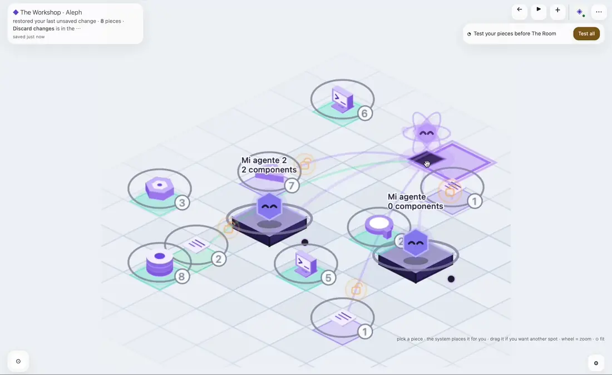
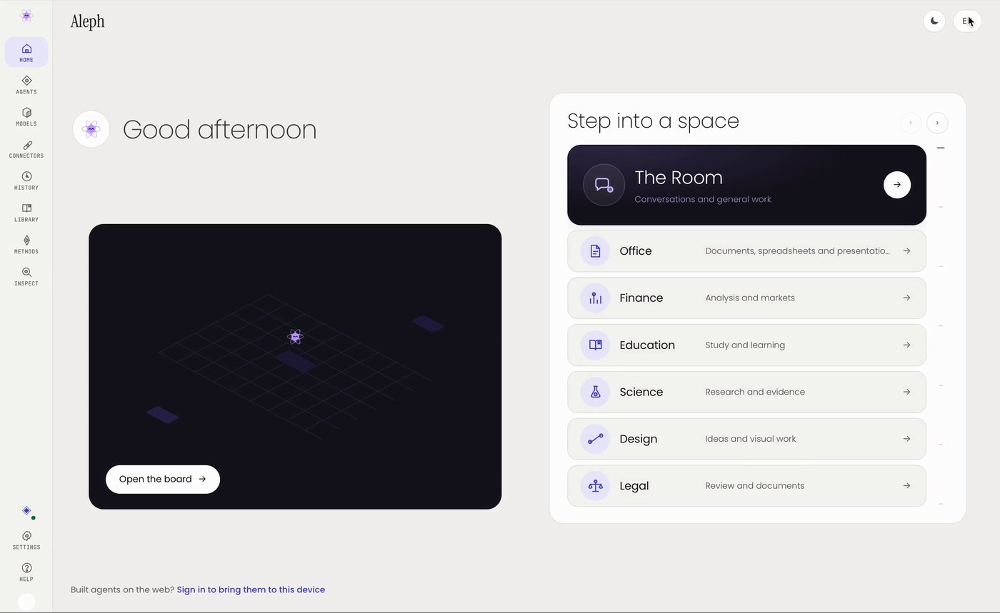
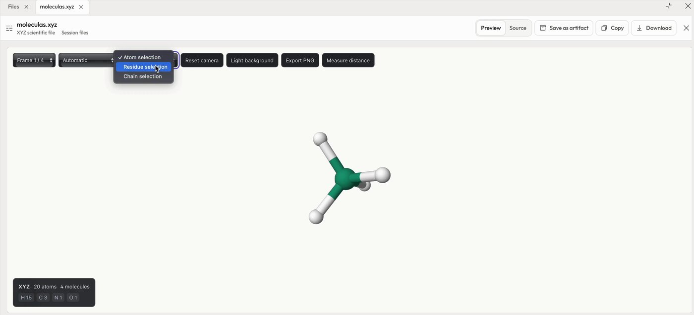
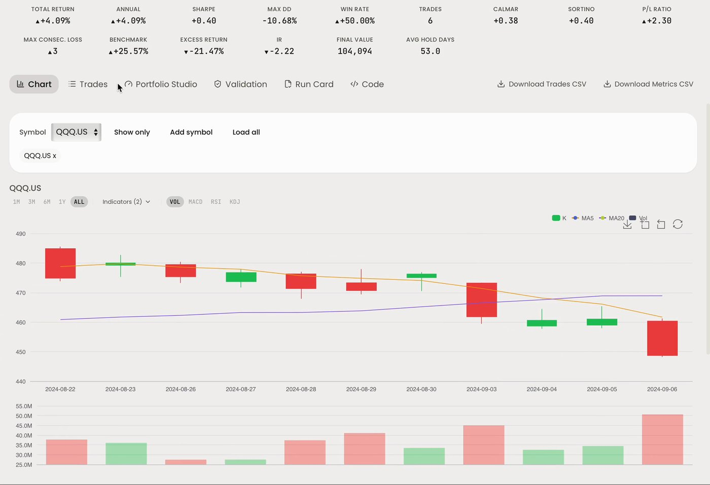
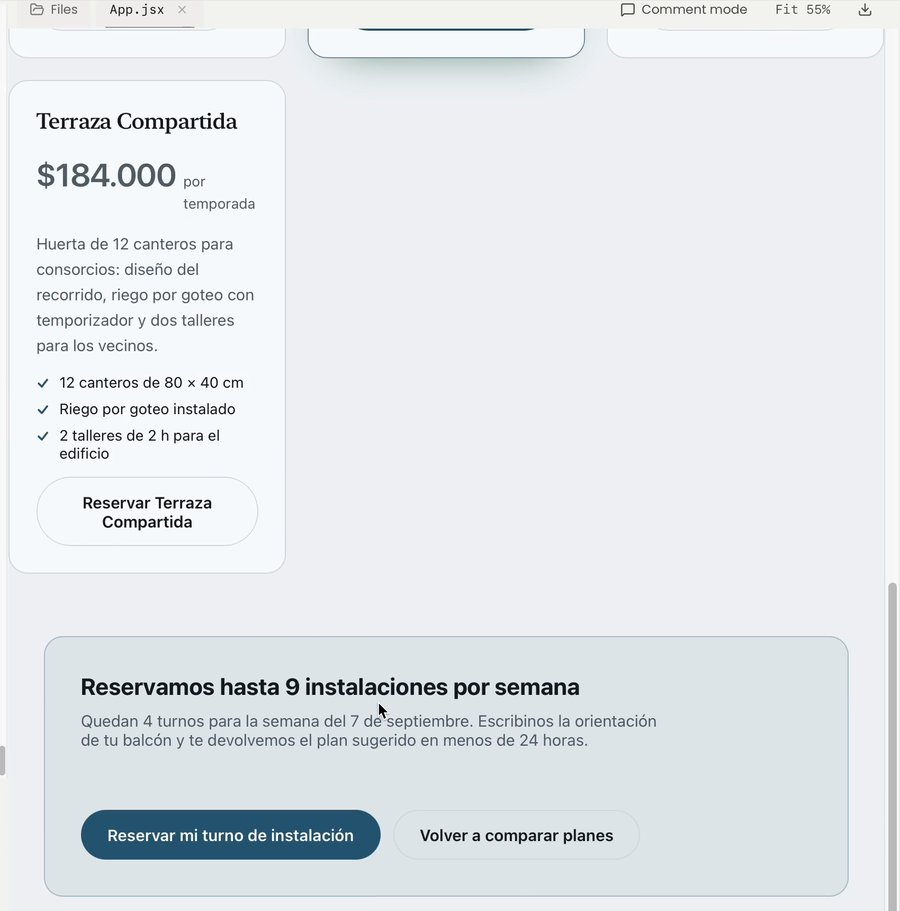
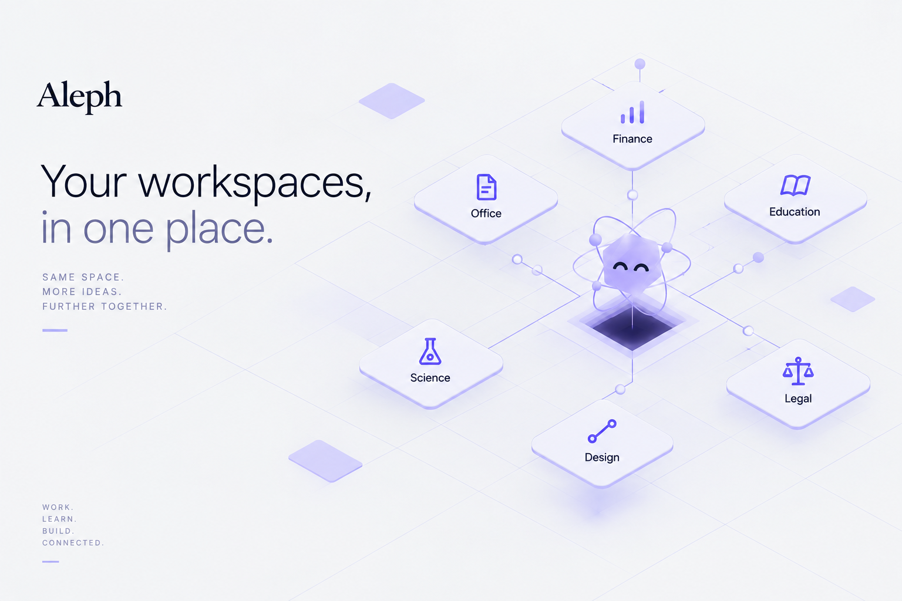
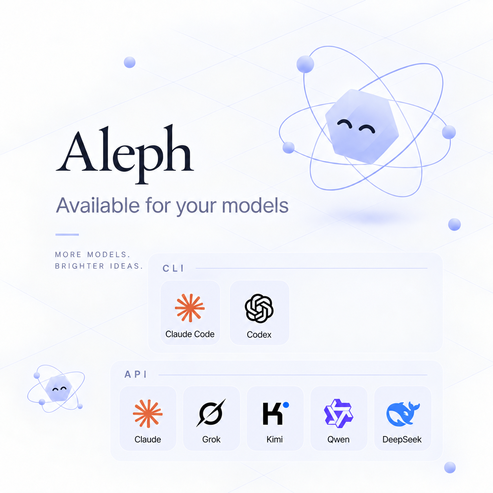
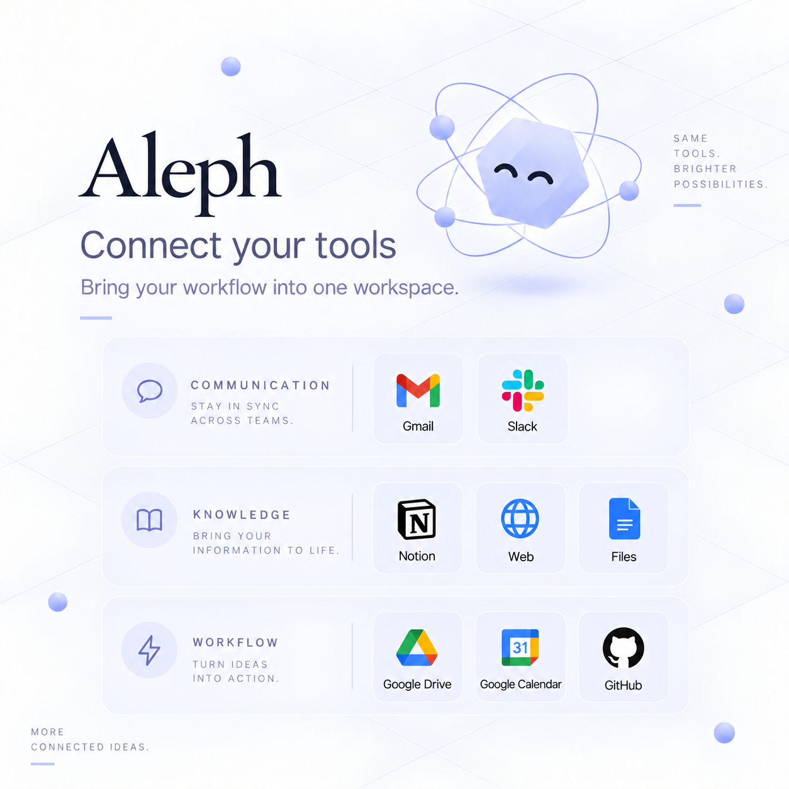

<div align="center">

**English** · [Español](README.es.md)

# Aleph

### One space. Infinite work.

A macOS workspace that brings your AI models, tools and files together, then puts them to work across focused workspaces and agents you build yourself.

[](https://github.com/josuecuguy1307/Aleph/releases/latest/download/Aleph-macOS-arm64.dmg)

[](https://github.com/josuecuguy1307/Aleph/releases/tag/v0.1.2)
[](LICENSE)


[Website](https://aleph-site-jade.vercel.app/) &nbsp;·&nbsp;
[Watch the trailer](#watch-the-trailer) &nbsp;·&nbsp;
[Install](#install) &nbsp;·&nbsp;
[How to use it](#how-to-use-aleph) &nbsp;·&nbsp;
[Getting Started](docs/GETTING_STARTED.md)



<sub>The Workshop: build an agent by placing its model and tools on the board, then step inside it to edit it.</sub>

</div>

---

## Why Aleph

Your AI work is scattered: one app for chat, another for files, a terminal for the CLI agent, a browser tab for every service. Aleph puts it in **one space**.

<table>
<tr>
<td width="33%" valign="top">
<h4>🧠 Your models</h4>
Connect an API provider or a CLI agent you already use, such as Claude Code or Codex. Aleph doesn't lock you into one vendor.
</td>
<td width="33%" valign="top">
<h4>🧰 Your tools</h4>
Equip agents with connectors and local tools, one at a time and on purpose. Connecting one thing never authorizes the others.
</td>
<td width="33%" valign="top">
<h4>🗂️ Your work</h4>
Files and artifacts stay next to the conversation that made them, in workspaces shaped for the job.
</td>
</tr>
</table>

## Watch the trailer

https://github.com/user-attachments/assets/ad208351-a6ba-4cf1-8096-6173cb717ee8

<sub>55 seconds. Can't see the player? [Download the trailer](assets/readme/aleph-trailer.mp4).</sub>

---

## A look inside

<table>
<tr>
<td colspan="2">
<br>
<b>Home.</b> Step into a space: The Room for conversations and general work, or a workspace built for one kind of job.
</td>
</tr>
<tr>
<td width="50%" valign="top">
<br>
<b>Science.</b> Scientific files open in real viewers, like this molecule viewer with selection modes and PNG export.
</td>
<td width="50%" valign="top">
<br>
<b>Finance.</b> Backtest metrics, trades and a candlestick chart for a strategy run, with CSV exports.
</td>
</tr>
<tr>
<td width="50%" valign="top">
<br>
<b>Design.</b> Describe a design and watch a live preview of the page take shape beside the chat.
</td>
<td width="50%" valign="top">
<br>
<b>Six workspaces, one shell.</b> Science, Education, Office, Finance, Legal and Design all open inside the same Aleph shell.
</td>
</tr>
</table>

<sub>Screenshots come from a development build of Aleph (September 2026), so details may differ from the 0.1.2 release. The illustration is a product concept, not a screenshot.</sub>

---

## The spaces

| Space | What it's for |
|---|---|
| 💬 **The Room** | Conversations and general work with an agent |
| 🛠️ **The Workshop** | Compose agents: pick a model, give it a goal, equip its tools |
| 📄 **Office** | Documents, spreadsheets and presentations |
| 📈 **Finance** | Analysis and markets |
| 🎓 **Education** | Study and learning |
| 🔬 **Science** | Research and evidence |
| 🎨 **Design** | Ideas and visual work |
| ⚖️ **Legal** | Review and documents |

<sub>In Spanish, The Room is *La Sala* and The Workshop is *El Cuarto*.</sub>

---

## Install

**macOS · Apple silicon**

1. [Download `Aleph-macOS-arm64.dmg`](https://github.com/josuecuguy1307/Aleph/releases/latest/download/Aleph-macOS-arm64.dmg).
2. Open the DMG.
3. Drag **Aleph.app** to **Applications**.
4. Open **Aleph** from Applications.

Or with Homebrew:

```sh
brew install --cask josuecuguy1307/tap/aleph
```

> [!NOTE]
> Aleph 0.1.2 is ad-hoc signed and **not notarized**, so macOS may block the first open. Try to open it once, then go to **System Settings → Privacy & Security → Open Anyway** ([Apple's instructions](https://support.apple.com/102445)). Only do this for a download from this official release. Homebrew installs the same app, with the same prompt.

---

## How to use Aleph

| | Step | What you do |
|---|---|---|
| 1 | **Open Aleph** | Follow the setup prompts and choose your language (English or Español). |
| 2 | **Choose your model** | Connect an API provider with your own credentials, or pick an installed and signed-in CLI such as Claude Code or Codex. |
| 3 | **Start in The Room** | Pick an agent, describe what you want, and open the files and artifacts it produces. |
| 4 | **Open a workspace** | Science, Education, Office, Finance, Legal or Design, depending on the work in front of you. |
| 5 | **Make it yours in The Workshop** | Compose agents, equip tools and arrange workflows you can come back to. |

[Continue with Getting Started →](docs/GETTING_STARTED.md)

---

## Your models. Your tools.

Bring the provider you want and connect the services your work needs. Models, CLI agents and connectors are separate capabilities: connecting one does not authorize the others.

| Models and CLI providers | Connected tools |
| --- | --- |
|  |  |

> [!IMPORTANT]
> Aleph is **model-agnostic**, and what you can use depends on your machine. Available models depend on your installed providers, sign-ins and access limits, and connectors may need installation, an API key or OAuth before they work. These illustrations show product concepts, not a promise that every integration is ready. **Onshape is optional and not certified.**

---

## Build from source

See [BUILDING.md](BUILDING.md) for prerequisites, the official build path and current reproducibility limitations.

## Open source

Aleph-owned source is licensed under [Apache-2.0](LICENSE). Third-party components keep their own licenses; see [THIRD_PARTY_NOTICES](THIRD_PARTY_NOTICES).

The **Aleph name, logo, mascot and official branding**, including the product imagery in this README, are covered separately by [TRADEMARKS.md](TRADEMARKS.md) and are not granted by Apache-2.0. Forks may describe their origin factually, but must not imply official status or endorsement. [Image provenance](assets/readme/README.md).

Want to contribute? Start with [CONTRIBUTING.md](CONTRIBUTING.md).

## Current release

**0.1.2** · [macOS installer and source release](https://github.com/josuecuguy1307/Aleph/releases/tag/v0.1.2)

<details>
<summary>Release details for developers</summary>

The release page separates the macOS installer from the developer-only guest assets. The exact guest kernel, root filesystem and matching third-party source bundle are also available there. [Guest asset details](deploy/guest/ASSETS.md) and [compliance](deploy/guest/COMPLIANCE.md) remain available for developers; full guest-image regeneration from source is not yet claimed. Don't use the guest kernel or root filesystem as the macOS installer.

The certified source baseline and snapshot scope are recorded in [SOURCE_PROVENANCE.json](SOURCE_PROVENANCE.json). This README is the product-facing introduction; the immutable `v0.1.2` tag preserves the original certified snapshot.

</details>
